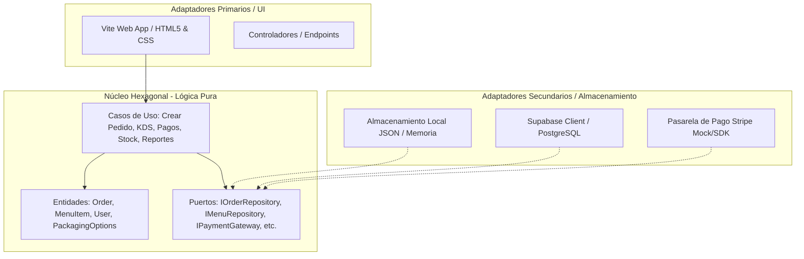
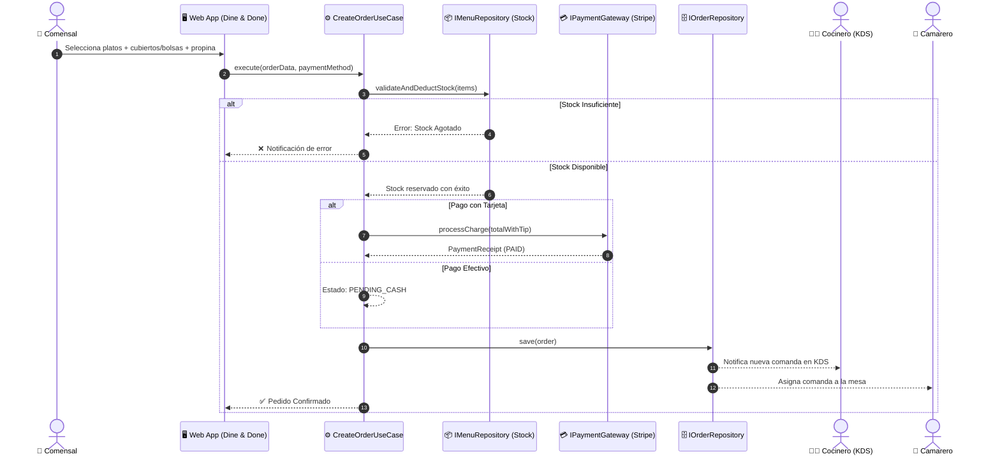

# Diseño Técnico y Arquitectura de Software - Dine & Done 🍽️📐

---

## 1. Principios Arquitectónicos

### 1.1. Arquitectura Hexagonal (Puertos y Adaptadores)
El proyecto se organiza estrictamente aislando el **Dominio** y las **Reglas de Negocio** de cualquier framework o infraestructura externa:



### 1.2. Zero Vendor Lock-in & Dual Storage Strategy
- La capa `src/core/` no tiene dependencias de `@supabase/supabase-js`, `stripe` o librerías del sistema operativo.
- La variable de entorno `USE_MOCK_DB=true` en `.env` activa adaptadores locales para ejecución 100% autónoma y offline sin requerir credenciales de nube.

---

## 2. Modelo de Dominio

### 2.1. Entidades Principales
- **`Order`**: Agregado raíz que modela el pedido, comensal, mesa, ítems pedidos, opciones de empaque, camarero/cocinero asignados, importes, propina y estados de cocina y cobro.
- **`MenuItem`**: Producto del menú con categoría, precio, indicador de si requiere cocina (`requiresCooking`), y stock disponible.
- **`PackagingOptions`**: Value object que encapsula si se solicitaron bolsas, envases plásticos y el número de sets de cubiertos.
- **`User`**: Usuario del sistema con su rol (`CUSTOMER`, `WAITER`, `CHEF`, `MANAGER`).

### 2.2. Diagrama de Secuencia: Ciclo de Vida del Pedido



---

## 3. Contratos de Puertos (Interfaces en `src/core/ports/`)

```typescript
export interface IOrderRepository {
  create(order: Order): Promise<Order>;
  findById(id: string): Promise<Order | null>;
  findAll(): Promise<Order[]>;
  updateStatus(id: string, status: OrderStatus): Promise<Order>;
  updatePaymentStatus(id: string, status: PaymentStatus): Promise<Order>;
  assignStaff(id: string, waiterId?: string, chefId?: string): Promise<Order>;
}

export interface IMenuRepository {
  getAll(): Promise<MenuItem[]>;
  getById(id: string): Promise<MenuItem | null>;
  deductStock(items: { menuItemId: string; quantity: number }[]): Promise<void>;
  updateStock(menuItemId: string, newStock: number): Promise<void>;
}

export interface IPaymentGateway {
  processPayment(request: {
    amount: number;
    tip: number;
    currency: string;
    customerEmail?: string;
  }): Promise<{ success: boolean; transactionId: string; timestamp: Date }>;
}

export interface IUserRepository {
  getAll(): Promise<User[]>;
  getById(id: string): Promise<User | null>;
  getByRole(role: UserRole): Promise<User[]>;
}
```

---

## 4. Esquema Relacional de Base de Datos (Supabase / PostgreSQL)

```sql
-- Extensión UUID
CREATE EXTENSION IF NOT EXISTS "uuid-ossp";

-- Tabla de Usuarios
CREATE TABLE users (
    id UUID PRIMARY KEY DEFAULT uuid_generate_v4(),
    name VARCHAR(100) NOT NULL,
    email VARCHAR(150) UNIQUE NOT NULL,
    role VARCHAR(30) NOT NULL CHECK (role IN ('CUSTOMER', 'WAITER', 'CHEF', 'MANAGER')),
    active BOOLEAN DEFAULT TRUE,
    created_at TIMESTAMP WITH TIME ZONE DEFAULT NOW()
);

-- Tabla del Menú
CREATE TABLE menu_items (
    id UUID PRIMARY KEY DEFAULT uuid_generate_v4(),
    name VARCHAR(120) NOT NULL,
    description TEXT,
    price NUMERIC(10, 2) NOT NULL CHECK (price >= 0),
    category VARCHAR(50) NOT NULL CHECK (category IN ('STARTER', 'MAIN', 'DESSERT', 'BEVERAGE')),
    requires_cooking BOOLEAN DEFAULT TRUE,
    stock INTEGER NOT NULL DEFAULT 0 CHECK (stock >= 0),
    image_url TEXT,
    created_at TIMESTAMP WITH TIME ZONE DEFAULT NOW()
);

-- Tabla de Pedidos / Comandas
CREATE TABLE orders (
    id UUID PRIMARY KEY DEFAULT uuid_generate_v4(),
    order_number VARCHAR(20) UNIQUE NOT NULL,
    table_number VARCHAR(10) NOT NULL,
    customer_name VARCHAR(100) NOT NULL,
    status VARCHAR(30) NOT NULL DEFAULT 'PLACED' CHECK (status IN ('PLACED', 'IN_KITCHEN', 'READY_TO_SERVE', 'DELIVERED', 'CANCELLED')),
    payment_status VARCHAR(30) NOT NULL DEFAULT 'PENDING_CASH' CHECK (payment_status IN ('PENDING_CASH', 'PAID', 'REFUNDED')),
    payment_method VARCHAR(30) NOT NULL CHECK (payment_method IN ('STRIPE_CARD', 'CASH')),
    subtotal NUMERIC(10, 2) NOT NULL,
    tip_amount NUMERIC(10, 2) DEFAULT 0.00,
    total NUMERIC(10, 2) NOT NULL,
    packaging_bags BOOLEAN DEFAULT FALSE,
    packaging_plastic BOOLEAN DEFAULT FALSE,
    cutlery_count INTEGER DEFAULT 0,
    waiter_id UUID REFERENCES users(id),
    chef_id UUID REFERENCES users(id),
    created_at TIMESTAMP WITH TIME ZONE DEFAULT NOW(),
    updated_at TIMESTAMP WITH TIME ZONE DEFAULT NOW()
);

-- Tabla de Ítems del Pedido
CREATE TABLE order_items (
    id UUID PRIMARY KEY DEFAULT uuid_generate_v4(),
    order_id UUID NOT NULL REFERENCES orders(id) ON DELETE CASCADE,
    menu_item_id UUID NOT NULL REFERENCES menu_items(id),
    item_name VARCHAR(120) NOT NULL,
    unit_price NUMERIC(10, 2) NOT NULL,
    quantity INTEGER NOT NULL CHECK (quantity > 0),
    notes TEXT
);
```
